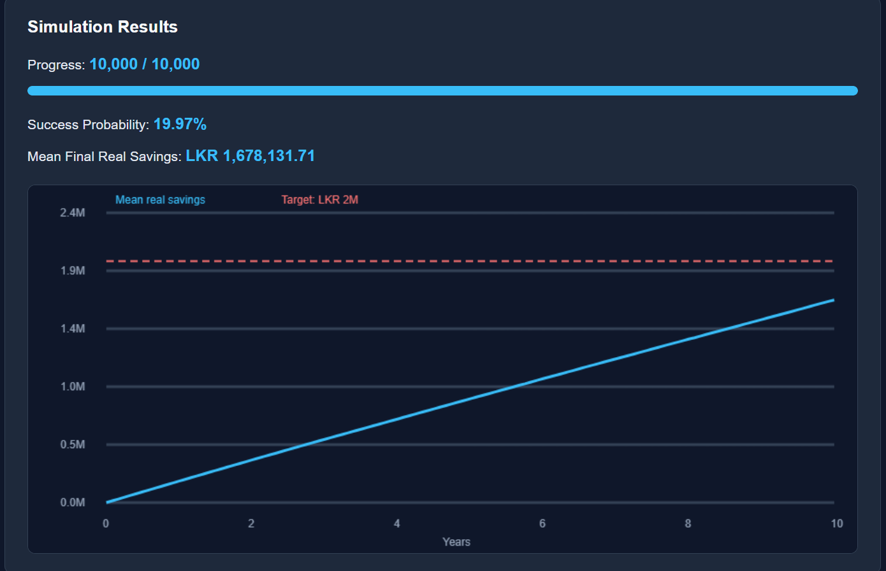
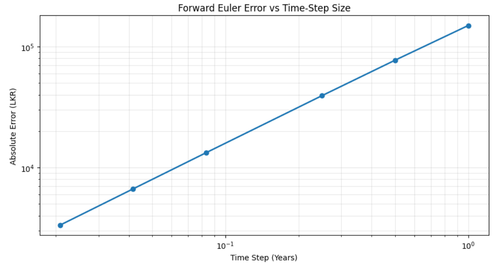

# Monte Carlo Savings Simulator

An interactive financial simulation that estimates the probability of achieving a long-term savings target under uncertain investment returns and inflation.

**[Live Demo](https://it23194380.github.io/monte-carlo-savings-simulator/)**

[](https://colab.research.google.com/github/it23194380/monte-carlo-savings-simulator/blob/main/notebook/monte-carlo-savings-simulator.ipynb)



## The problem

Long-term financial planning is challenging because investment returns fluctuate and inflation reduces the purchasing power of accumulated savings. Traditional savings calculators typically assume constant financial rates and provide a single estimated future balance, without accounting for uncertainty.

This project uses Monte Carlo simulation to estimate the probability that an individual contributing LKR 15,000 per month can accumulate the equivalent of LKR 2,000,000 in today's purchasing power over ten years.

## Quick start

**Notebook:** Click the Open in Colab badge above, then select Runtime → Run all. The notebook uses NumPy and Matplotlib and runs on a standard free Colab runtime.

**Web demo:** Open the live demo using the link above, or download this repository and double-click `docs/index.html`.

**Run locally (optional):**

```bash
pip install -r requirements.txt
jupyter notebook notebook/monte-carlo-savings-simulator.ipynb
```

## Using the demo

Adjust the monthly contribution, expected annual investment return and annual inflation rate to explore different financial scenarios.

Use the Start, Pause and Reset controls to manage the simulation. The visualisation displays possible savings trajectories and quantitative outputs, including the estimated probability of reaching the financial target.

Full guide: [USER_GUIDE.md](USER_GUIDE.md).

## Model and mathematics

The simulation models monthly savings accumulation using independently generated normally distributed investment returns and inflation rates.

The nominal savings balance is updated using:

$$
B_{t+1}=B_t(1+R_t)+C
$$

The cumulative inflation index is updated using:

$$
I_{t+1}=I_t(1+\pi_t)
$$

The inflation-adjusted savings balance is calculated as:

$$
B_t^{real}=\frac{B_t}{I_t}
$$

The probability of achieving the savings target is estimated from the proportion of successful Monte Carlo simulation paths.

### Baseline parameters

| Parameter | Value |
|---|---:|
| Initial savings | LKR 0 |
| Monthly contribution | LKR 15,000 |
| Investment duration | 10 years |
| Inflation-adjusted target | LKR 2,000,000 |
| Expected annual investment return | 8% |
| Annual investment return volatility | 12% |
| Expected annual inflation | 5% |
| Annual inflation volatility | 2% |
| Number of simulations | 10,000 |
| Random seed | 42 |

A supplementary deterministic savings model is solved using the Forward Euler method to investigate numerical accuracy and time-step convergence.

Full derivations, assumptions and parameters: [THEORY.md](THEORY.md).

## Verification

The simulation was verified using deterministic analytical comparisons and numerical convergence experiments.

- The deterministic compound-interest calculation produced approximately LKR 2,744,190.53, matching the simulated balance within numerical tolerance.
- The zero-return scenario produced LKR 1,800,000, equal to the total contributions.
- The zero-inflation scenario confirmed that nominal and real savings are equal.
- Forward Euler numerical errors decreased as the time-step size was reduced, supporting the expected first-order convergence behaviour.

Automated assertions are included in the notebook to verify the implementation.



## Concepts applied

- **Input modelling and random variate generation:** Normal distributions represent uncertain monthly investment returns and inflation.
- **Monte Carlo simulation:** Repeated random sampling generates possible savings trajectories and estimates target-achievement probability.
- **Law of large numbers:** Increasing the number of simulations supports more precise probability estimation.
- **Statistical uncertainty quantification:** Wilson confidence intervals quantify uncertainty in the estimated success probability.
- **Numerical ODE integration:** Forward Euler approximates a deterministic continuous-contribution savings model.
- **Verification and convergence analysis:** Analytical comparisons and time-step refinement assess numerical correctness.
- **Sensitivity analysis:** Individual financial parameters are varied to investigate their influence on simulation outcomes.

## Results

The baseline simulation produced the following results across 10,000 independent savings paths.

| Metric | Result |
|---|---:|
| Total nominal contributions | LKR 1,800,000 |
| Mean final real savings | LKR 1,673,494.37 |
| Median final real savings | LKR 1,618,263.52 |
| Standard deviation | LKR 412,340.83 |
| Successful simulations | 1,900 |
| Target-achievement probability | 19.00% |
| 95% Wilson confidence interval | 18.24%–19.78% |

Under the baseline assumptions, an individual saving LKR 15,000 per month has an estimated 19% probability of reaching the inflation-adjusted target within ten years.

### Sensitivity analysis

| Monthly contribution | Success probability |
|---|---:|
| LKR 10,000 | 0.74% |
| LKR 15,000 | 19.00% |
| LKR 20,000 | 62.75% |
| LKR 25,000 | 89.81% |
| LKR 30,000 | 98.12% |

Increasing monthly contributions substantially improves the probability of achieving the savings target. Higher expected investment returns also improve the probability, while higher inflation reduces it.

These results are conditional on the assumed financial parameters and should not be interpreted as guaranteed financial outcomes.

Additional verification and experimental plots are available in the [figures directory](figures/).

## Limitations and future work

- Investment returns and inflation are assumed to follow independent normal distributions.
- Financial parameters are illustrative rather than calibrated using historical market data.
- Monthly contributions remain constant throughout the investment period.
- Taxes, transaction costs, investment management fees and withdrawals are excluded.
- Future work could incorporate historical financial data, correlated financial variables, alternative probability distributions and variable contribution strategies.

The simulator is intended for educational and exploratory purposes and does not constitute financial advice.

## Key references

1. N. Metropolis and S. Ulam, "The Monte Carlo Method," Journal of the American Statistical Association, 1949. https://doi.org/10.1080/01621459.1949.10483310

2. P. P. Boyle, "Options: A Monte Carlo Approach," Journal of Financial Economics, 1977. https://doi.org/10.1016/0304-405X(77)90005-8

3. P. Glasserman, Monte Carlo Methods in Financial Engineering, Springer, 2004. https://doi.org/10.1007/978-0-387-21617-1

4. L. D. Brown, T. T. Cai and A. DasGupta, "Interval Estimation for a Binomial Proportion," Statistical Science, 2001. https://doi.org/10.1214/ss/1009213286

Full list: [REFERENCES.md](REFERENCES.md).

## AI assistance

AI coding and writing assistants were used to support mathematical explanations, implementation, debugging, documentation and experimental design. The simulation includes analytical verification and automated assertions to assess the correctness of the implementation.

## Licence and credits

Code: [MIT Licence](LICENSE).

Data: No external datasets are used. Simulation inputs are generated synthetically from specified financial parameters and probability distributions.

Built using Python, NumPy, Matplotlib, HTML, CSS and JavaScript.
