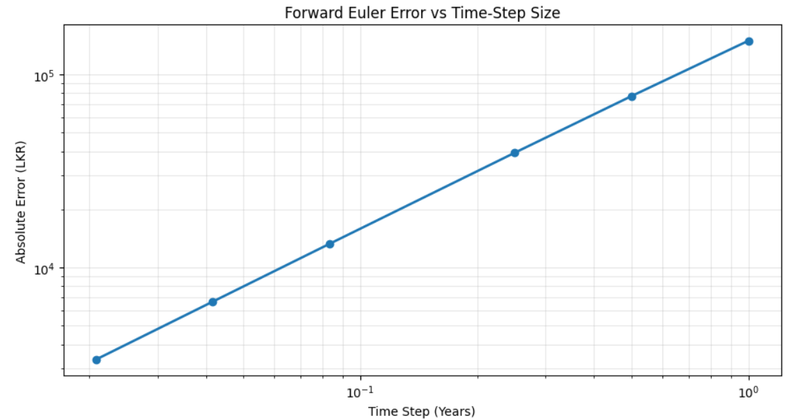

# Theory and Mathematics

## 1. Problem formulation

Long-term savings accumulation is influenced by uncertain investment returns and changes in purchasing power caused by inflation. Conventional savings calculations assume constant financial rates and therefore cannot adequately represent the range of possible financial outcomes.

This project uses Monte Carlo simulation to answer the following question:

**What is the probability that an individual contributing LKR 15,000 per month will accumulate the equivalent of LKR 2,000,000 in today's purchasing power within ten years?**

The main quantities of interest are:

- Nominal savings balance.
- Cumulative inflation index.
- Inflation-adjusted savings balance.
- Distribution of final real savings.
- Probability of achieving the financial target.
- Statistical uncertainty associated with the estimated probability.

The model also investigates the sensitivity of target-achievement probability to monthly contributions, expected investment returns and expected inflation.

## 2. Assumptions

1. **Fixed monthly contributions:** Contributions remain constant throughout each simulation to isolate the effects of investment returns and inflation.

2. **End-of-month contributions:** Contributions are deposited after applying the investment return for the current month.

3. **Normally distributed investment returns:** Monthly investment returns are generated using a normal distribution as a simplified representation of financial uncertainty.

4. **Normally distributed inflation:** Monthly inflation rates are generated using a normal distribution to represent uncertainty in purchasing power.

5. **Independence:** Investment returns and inflation are assumed to be independent of each other, with independent draws across months.

6. **Constant distribution parameters:** Expected returns, inflation rates and their respective volatilities remain unchanged throughout the simulation.

7. **No additional financial costs:** Taxes, transaction costs, investment management fees and withdrawals are excluded.

8. **Illustrative financial parameters:** The model uses assumed financial parameters rather than historically calibrated market data.

9. **Fixed financial target:** The savings target is expressed in today's purchasing power.

10. **Reproducibility:** A fixed random seed is used in the Python notebook to support reproducible experiments.

## 3. Model equations

### 3.1 Monthly investment returns

Annual investment return parameters are converted into monthly parameters using:

$$
\mu_{R,m}=\frac{\mu_R}{12}
$$

$$
\sigma_{R,m}=\frac{\sigma_R}{\sqrt{12}}
$$

Monthly investment returns are generated from:

$$
R_t \sim \mathcal{N}\left(\frac{\mu_R}{12},\frac{\sigma_R^2}{12}\right)
$$

The second parameter of the normal distribution represents its variance.

### 3.2 Monthly inflation

Annual inflation parameters are converted into monthly parameters using:

$$
\mu_{\pi,m}=\frac{\mu_\pi}{12}
$$

$$
\sigma_{\pi,m}=\frac{\sigma_\pi}{\sqrt{12}}
$$

Monthly inflation rates are generated from:

$$
\pi_t \sim \mathcal{N}\left(\frac{\mu_\pi}{12},\frac{\sigma_\pi^2}{12}\right)
$$

These conversions represent an annualised arithmetic-rate modelling assumption rather than an exact conversion of effective annual compound rates.

### 3.3 Nominal savings accumulation

The nominal savings balance is updated each month using:

$$
B_{t+1}=B_t(1+R_t)+C
$$

The initial condition is:

$$
B_0=0
$$

The existing balance grows or declines according to the randomly generated investment return. The monthly contribution is then added.

### 3.4 Cumulative inflation index

The cumulative inflation index is calculated using:

$$
I_{t+1}=I_t(1+\pi_t)
$$

The initial inflation index is:

$$
I_0=1
$$

This index represents the cumulative change in prices relative to the beginning of the simulation.

### 3.5 Inflation-adjusted savings

The real savings balance is calculated using:

$$
B_t^{real}=\frac{B_t}{I_t}
$$

Real savings represent the purchasing power of accumulated savings in today's monetary terms.

### 3.6 Target-achievement probability

For simulation path i, define the success indicator:

$$
X_i=\mathbf{1}\left(B_{T,i}^{real}\geq G\right)
$$

The indicator equals one when the final real savings reach or exceed the target and zero otherwise.

The Monte Carlo estimate of success probability is:

$$
\hat{p}=\frac{1}{N}\sum_{i=1}^{N}X_i
$$

The percentage probability is:

$$
P_{\text{success}}=100\hat{p}
$$

### 3.7 Statistical uncertainty

The estimated standard error of the Monte Carlo probability is:

$$
SE=\sqrt{\frac{\hat{p}(1-\hat{p})}{N}}
$$

A 95% Wilson confidence interval for the baseline success probability is calculated using:

$$
CI=
\frac{
\hat{p}+\frac{z^2}{2N}
\pm
z\sqrt{\frac{\hat{p}(1-\hat{p})}{N}+\frac{z^2}{4N^2}}
}{
1+\frac{z^2}{N}
}
$$

where z = 1.96 for a 95% confidence level.

The interval quantifies sampling uncertainty in the estimated probability under the assumed model. It does not account for uncertainty in the validity of the financial assumptions themselves.

### 3.8 Model parameters

| Symbol | Meaning | Units | Baseline value | Source |
|---|---|---|---|---|
| B₀ | Initial savings balance | LKR | 0 | Model assumption |
| Bₜ | Nominal savings balance | LKR | Calculated | Model equation |
| C | Monthly contribution | LKR/month | 15,000 | Illustrative assumption |
| Rₜ | Monthly investment return | Decimal rate | Randomly generated | Normal distribution |
| μR | Expected annual investment return | % per year | 8% | Illustrative assumption |
| σR | Annual investment return volatility | Annualised % | 12% | Illustrative assumption |
| πₜ | Monthly inflation rate | Decimal rate | Randomly generated | Normal distribution |
| μπ | Expected annual inflation | % per year | 5% | Illustrative assumption |
| σπ | Annual inflation volatility | Annualised % | 2% | Illustrative assumption |
| Iₜ | Cumulative inflation index | Dimensionless | Calculated | Model equation |
| Bₜ real | Inflation-adjusted savings | LKR | Calculated | Model equation |
| G | Real savings target | LKR | 2,000,000 | Model assumption |
| T | Simulation duration | Months | 120 | Model assumption |
| N | Number of simulation paths | Count | 10,000 | Experimental design |
| p̂ | Estimated success probability | Dimensionless | Calculated | Monte Carlo estimator |
| z | Confidence interval critical value | Dimensionless | 1.96 | Standard normal distribution |
| Seed | Random-number generator seed | Integer | 42 | Reproducibility |

## 4. Numerical method

### 4.1 Monte Carlo simulation

Monte Carlo simulation is the primary computational method used in this project.

The algorithm consists of the following steps:

1. Initialise the savings balance to zero and the inflation index to one.
2. Generate random monthly investment returns and inflation rates.
3. Update the nominal savings balance.
4. Update the cumulative inflation index.
5. Calculate the inflation-adjusted savings balance.
6. Repeat the monthly calculations for 120 months.
7. Determine whether the final real savings reach the financial target.
8. Repeat the process for 10,000 independent simulation paths.
9. Calculate the mean, median, standard deviation and success probability.
10. Calculate a 95% Wilson confidence interval for the estimated probability.

The Python implementation uses NumPy for numerical calculations and random variate generation, and Matplotlib for visualisation.

The computational complexity is approximately:

$$
O(NT)
$$

where N is the number of simulation paths and T is the number of monthly time steps.

### 4.2 Monte Carlo convergence

The law of large numbers supports convergence of the estimated success probability towards the underlying model probability as the number of independent simulation paths increases.

Monte Carlo sampling error decreases approximately at the rate:

$$
O(N^{-1/2})
$$

The baseline sample size of 10,000 paths provides a practical balance between statistical precision and computational cost.

The notebook investigates sample sizes of 100, 500, 1,000, 2,000, 5,000 and 10,000.

| Number of simulations | Estimated success probability |
|---:|---:|
| 100 | 12.00% |
| 500 | 18.40% |
| 1,000 | 16.40% |
| 2,000 | 18.55% |
| 5,000 | 18.36% |
| 10,000 | 19.00% |

The estimates fluctuate as additional samples are included. The nested-sample experiment illustrates the evolution of the probability estimate but does not independently establish statistical convergence.

### 4.3 Deterministic savings model

A supplementary deterministic model is introduced to investigate numerical integration accuracy.

The continuous savings accumulation model is:

$$
\frac{dB}{dt}=rB+c
$$

where:

- B is the savings balance in LKR.
- r is the constant annual investment growth rate.
- c is the annual continuous contribution rate in LKR per year.
- t is time measured in years.

The baseline deterministic parameters are:

- Initial savings: LKR 0.
- Annual growth rate: 0.08 per year.
- Annual continuous contribution rate: LKR 180,000 per year.
- Simulation duration: 10 years.

For a nonzero growth rate, the analytical solution is:

$$
B(t)=B_0e^{rt}+\frac{c}{r}(e^{rt}-1)
$$

For zero initial savings:

$$
B(t)=\frac{c}{r}(e^{rt}-1)
$$

For zero growth:

$$
B(t)=B_0+ct
$$

This continuous-contribution model is distinct from the primary stochastic monthly savings model.

### 4.4 Forward Euler method

The deterministic differential equation is approximated using Forward Euler:

$$
B_{n+1}=B_n+\Delta t(rB_n+c)
$$

where the time-step size is measured in years.

Forward Euler has first-order global accuracy:

$$
E(\Delta t)=O(\Delta t)
$$

Reducing the time-step size should therefore reduce the global numerical error approximately proportionally.

For the linear test equation, the Forward Euler amplification factor is:

$$
g=1+r\Delta t
$$

For decaying systems with a negative growth coefficient, absolute stability requires:

$$
|1+r\Delta t|<1
$$

In the positive-growth savings model, increasing balances are expected physical behaviour rather than evidence of numerical instability. Time-step refinement is used to assess numerical accuracy.

The supplementary Euler experiment uses progressively smaller time steps and compares the numerical results against the analytical continuous savings solution.

The primary Monte Carlo model uses a fixed monthly time step because monthly contributions and monthly financial rates define its discrete financial process.

## 5. Verification

Verification evaluates whether the implementation correctly represents the intended mathematical model.

### 5.1 Analytical compound-interest verification

Under deterministic conditions with constant monthly investment returns and zero inflation, the analytical future value of end-of-month contributions is:

$$
FV=C\frac{(1+r_m)^T-1}{r_m}
$$

where:

$$
r_m=\frac{0.08}{12}
$$

For 120 monthly contributions of LKR 15,000, the expected final balance is approximately LKR 2,744,190.53.

The simulated balance matches this analytical result within floating-point numerical tolerance.

### 5.2 Zero-return verification

When investment returns are zero, the final nominal savings balance should equal the total contributions:

$$
B_T=B_0+CT
$$

Therefore:

$$
B_T=15000\times120=1800000
$$

The simulation produces the expected balance of LKR 1,800,000.

### 5.3 Zero-inflation verification

When inflation is zero throughout the simulation:

$$
I_t=1
$$

Therefore:

$$
B_t^{real}=B_t
$$

This limiting case checks that the inflation-adjustment calculation preserves nominal savings when prices remain unchanged.

### 5.4 Verification summary

| Check | Expected | Obtained | Pass? |
|---|---|---|---|
| Deterministic compound interest | LKR 2,744,190.53 | LKR 2,744,190.53 | Yes |
| Zero investment return | LKR 1,800,000 | LKR 1,800,000 | Yes |
| Zero inflation | Real savings equal nominal savings | Equal balances | Yes |
| Forward Euler refinement | Error decreases as time step decreases | Decreasing numerical error | Yes |

The absolute difference between the analytical and simulated compound-interest balances is approximately LKR 0.0000000284.

Automated assertions are included in the notebook to support verification.

### 5.5 Forward Euler convergence

The analytical solution of the deterministic continuous-contribution model after ten years is approximately LKR 2,757,467.09.

| Time-step size (years) | Numerical balance (LKR) | Absolute error (LKR) |
|---:|---:|---:|
| 1 | 2,607,581.24 | 149,885.85 |
| 0.5 | 2,680,027.07 | 77,440.02 |
| 0.25 | 2,718,089.24 | 39,377.85 |
| 1/12 | 2,744,190.53 | 13,276.56 |
| 1/24 | 2,750,809.70 | 6,657.39 |
| 1/48 | 2,754,133.59 | 3,333.50 |

The numerical error decreases as the time-step size is reduced.

For sufficiently small time steps, halving the step size approximately halves the error, supporting the expected first-order convergence behaviour of Forward Euler.

### 5.6 Baseline Monte Carlo results

| Metric | Result |
|---|---:|
| Number of simulation paths | 10,000 |
| Mean final real savings | LKR 1,673,494.37 |
| Median final real savings | LKR 1,618,263.52 |
| Standard deviation | LKR 412,340.83 |
| Successful simulation paths | 1,900 |
| Estimated success probability | 19.00% |
| 95% Wilson confidence interval | 18.24%–19.78% |

The baseline results indicate that the specified savings strategy has an estimated 19% probability of achieving the inflation-adjusted financial target under the assumed model conditions.

### 5.7 Sensitivity analysis

One-at-a-time sensitivity analysis is performed by varying one financial parameter while holding the remaining parameters at their baseline values.

#### Monthly contribution

| Monthly contribution (LKR) | Success probability |
|---:|---:|
| 10,000 | 0.74% |
| 15,000 | 19.00% |
| 20,000 | 62.75% |
| 25,000 | 89.81% |
| 30,000 | 98.12% |

#### Expected annual investment return

| Expected annual return | Success probability |
|---:|---:|
| 4% | 3.77% |
| 6% | 9.22% |
| 8% | 19.00% |
| 10% | 34.09% |
| 12% | 52.44% |

#### Expected annual inflation

| Expected annual inflation | Success probability |
|---:|---:|
| 2% | 64.66% |
| 4% | 31.93% |
| 5% | 19.00% |
| 6% | 10.09% |
| 8% | 1.98% |

The results demonstrate that higher contributions and expected investment returns improve the probability of reaching the financial target, while higher inflation reduces it.

These findings are conditional on the assumed financial parameters and should not be interpreted as guaranteed real-world outcomes.

Additional experimental figures are available in the [figures directory](figures/).

## 6. Concepts applied

| Concept | Where it is used in this project |
|---|---|
| Input modelling | Normal probability distributions represent uncertain investment returns and inflation. |
| Random variate generation | NumPy generates monthly investment returns and inflation rates. |
| Monte Carlo simulation | Repeated random sampling generates 10,000 possible savings trajectories. |
| Monte Carlo integration | The expected value of the success indicator is estimated using the sample mean. |
| Law of large numbers | Increasing simulation sample size supports convergence of the probability estimator. |
| Confidence intervals | A Wilson confidence interval quantifies sampling uncertainty in the baseline success probability. |
| Discrete-time dynamic modelling | Monthly recurrence equations describe savings accumulation and cumulative inflation. |
| Ordinary differential equations | A supplementary deterministic model represents continuous savings accumulation. |
| Forward Euler integration | The deterministic savings differential equation is solved numerically. |
| Numerical convergence | Time-step refinement investigates the accuracy of the Forward Euler method. |
| Analytical verification | Deterministic compound-interest calculations and limiting cases verify the implementation. |
| Sensitivity analysis | Contributions, investment returns and inflation are varied independently to investigate their effects. |
| Reproducibility | Fixed financial parameters and random seed 42 support repeatable notebook experiments. |

## 7. References

The theoretical foundations of this project include Monte Carlo simulation, probability theory, financial mathematics, numerical integration and statistical confidence intervals.

See [REFERENCES.md](REFERENCES.md) for the complete reference list.

For implementation instructions and interactive examples, see [README.md](README.md) and [USER_GUIDE.md](USER_GUIDE.md).
