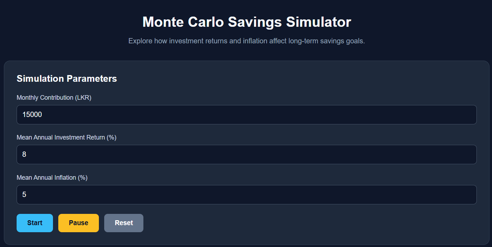

# User Guide: Monte Carlo Savings Simulator

**Open the demo:** https://it23194380.github.io/monte-carlo-savings-simulator/

The simulator runs entirely in your browser using HTML, CSS and JavaScript. It supports modern browsers such as Google Chrome, Microsoft Edge and Mozilla Firefox. No installation, account registration or data upload is required.

## Controls

| Control | What it does | Default |
|---|---|---|
| Monthly Contribution | Amount deposited at the end of each month, measured in LKR | LKR 15,000 |
| Expected Annual Investment Return | Expected annual percentage return on accumulated savings | 8% |
| Expected Annual Inflation | Expected annual percentage increase in prices | 5% |
| Start | Starts or resumes the Monte Carlo simulation | — |
| Pause | Temporarily pauses the simulation | — |
| Reset | Clears the simulation so a new experiment can be performed | — |

### Baseline simulation settings

- Initial savings: LKR 0
- Investment duration: 10 years
- Inflation-adjusted savings target: LKR 2,000,000
- Annual investment return volatility: 12%
- Annual inflation volatility: 2%
- Number of simulations: 10,000
- Random seed: 42

## Reading the outputs

- **Savings trajectories:** The graph displays possible inflation-adjusted savings balances over the investment period. Different trajectories represent different randomly generated financial scenarios.

- **Target achievement probability:** The percentage of simulated savings paths that reach or exceed the inflation-adjusted financial target at the end of the investment period.

- **Mean final real savings:** The average final savings balance across the simulated paths, expressed in today's purchasing power.

- **Savings target:** The financial goal against which the simulated final balances are compared.

The simulation produces estimates rather than guaranteed financial predictions. Results depend on the selected financial parameters and random sampling.

## Try this

### Scenario 1: Baseline savings plan

1. Set the monthly contribution to LKR 15,000.
2. Set the expected annual investment return to 8%.
3. Set the expected annual inflation to 5%.
4. Press Start and allow the simulation to complete.
5. Observe the savings trajectories and estimated success probability.

The reference notebook produces a success probability of approximately 19%.

### Scenario 2: Increase monthly contributions

1. Reset the simulation.
2. Increase the monthly contribution to LKR 20,000.
3. Keep the investment return and inflation unchanged.
4. Press Start.

Observe how the probability of reaching the savings target increases. The reference notebook produces a success probability of approximately 62.75%.

### Scenario 3: Increase expected investment returns

1. Reset the simulation.
2. Set the monthly contribution to LKR 15,000.
3. Increase the expected annual investment return to 10%.
4. Keep inflation at 5%.
5. Press Start.

The reference notebook produces a success probability of approximately 34.09%, demonstrating the effect of higher expected investment returns.

### Scenario 4: Increase inflation

1. Reset the simulation.
2. Set the monthly contribution to LKR 15,000.
3. Set the expected annual investment return to 8%.
4. Increase expected annual inflation to 8%.
5. Press Start.

The reference notebook produces a success probability of approximately 1.98%, demonstrating how higher inflation reduces the purchasing power of accumulated savings.

## Check against the notebook

The web demonstration implements the same monthly savings accumulation and inflation-adjustment model as the Python notebook.

Under the baseline settings, the reference notebook produces:

| Metric | Notebook reference result |
|---|---:|
| Target achievement probability | 19.00% |
| Mean final real savings | LKR 1,673,494.37 |
| 95% confidence interval for success probability | 18.24%–19.78% |

The proposed acceptance tolerances for comparing the browser implementation with the notebook are:

- Success probability: ±2 percentage points.
- Mean final real savings: ±2% relative difference.

Small numerical differences are expected because Python and JavaScript use different random-number generation implementations.

The reference results are available in Section 6 — Experiments and Results of the notebook.

[Open the reference notebook in Google Colab](https://colab.research.google.com/drive/1x6ECUrG9emrF_xUZnn9jgHX9Cj8ueo0m?usp=sharing)

## Limitations

- The simulator assumes normally distributed investment returns and inflation rates.
- Investment returns and inflation are assumed to be independent.
- Financial parameters are illustrative and are not calibrated using historical financial data.
- Monthly contributions remain constant throughout each simulation.
- Taxes, investment fees, transaction costs and withdrawals are excluded.
- Extreme financial parameter settings may produce unrealistic outcomes.
- The web demonstration focuses on interactive scenario exploration, while the notebook provides additional verification, sensitivity analysis and numerical convergence experiments.

This simulator is intended for educational and exploratory purposes only. It does not provide professional financial advice.

## Further information

- [Project overview](README.md)
- [Mathematical model and assumptions](THEORY.md)
- [References](REFERENCES.md)
- [Source code and licence](LICENSE)
